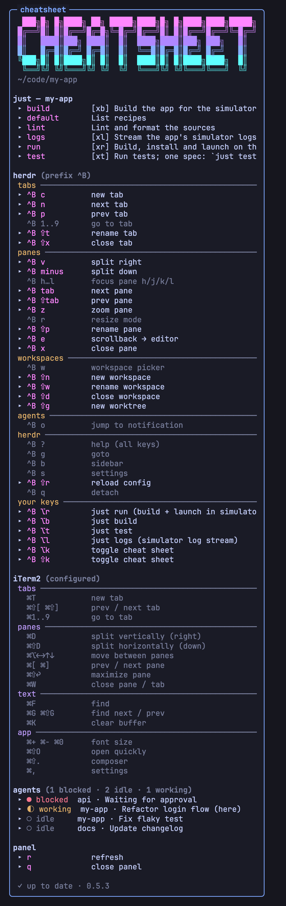

# herdr-cheatsheet

<p align="center">
  
</p>

A clickable cheat-sheet panel for [herdr](https://herdr.dev). It docks on the right of your tabs and shows:

- **Banner**: the logo in the "ANSI Shadow" style, with a retro color gradient and the focused project's path. Smaller panels get a compact logo.
- **just**: the recipes of the project you're working in, from the nearest `justfile` above the focused pane's directory. It follows focus between projects.
- **herdr**: the core keybindings resolved from herdr's defaults plus your `config.toml` overrides, and all of your custom `[[keys.command]]` bindings with their descriptions.
- **Terminal keys**: the default shortcuts of the terminal emulator you're attached from, detected automatically, with separate macOS and Linux lists. See [Terminal detection](#terminal-detection).
- **Agents**: every agent pane across your workspaces with its status, with blocked and finished agents first. `(here)` marks the ones in the current tab.
- **Update notice**: when a newer version is on GitHub, an `update to x.y.z` row appears under the banner. Click it or press `u` to run `herdr plugin update`, which shows what changed and asks before installing. Afterwards every open panel restarts on the new version. Otherwise a dim line at the bottom confirms `✓ up to date` with the installed version, or says the check failed.

Rows marked `▸` run when you click them:

- **Recipes** run inside the panel. Press any key to return, and Ctrl-C stops long-running ones.
- **herdr actions** like new tab, split, zoom, next pane, move tab or close tab run through herdr. Close rows act immediately. Rename and new-worktree rows ask for a name inside the panel.
- **Your custom bindings** run as configured: plugin actions through herdr, `pane` and `popup` commands inside the panel, `shell` commands in the background.
- **Agents** take you to that agent's pane, in any workspace.

```
 ███╗█╗ █╗████╗ ██╗ █████╗████╗█╗ █╗████╗████╗█████╗
█╔══╝█║ █║█╔══╝█╔═█╗╚═█╔═╝█╔══╝█║ █║█╔══╝█╔══╝╚═█╔═╝
█║   ████║███╗ ████║  █║  ████╗████║███╗ ███╗   █║
█║   █╔═█║█╔═╝ █╔═█║  █║  ╚══█║█╔═█║█╔═╝ █╔═╝   █║
╚███╗█║ █║████╗█║ █║  █║  ████║█║ █║████╗████╗  █║
 ╚══╝╚╝ ╚╝╚═══╝╚╝ ╚╝  ╚╝  ╚═══╝╚╝ ╚╝╚═══╝╚═══╝  ╚╝
 ~/code/my-app

just — my-app
 ▸ build         [xb] Build the app for the simulator
 ▸ run           [xr] Build, install and launch on the simulator
 ▸ test          [xt] Run tests; one spec: `just test SomeSpec`

herdr (prefix ^B)
   ^B ?          help (all keys)
 ▸ ^B c          new tab
 ▸ ^B ⇧t         rename tab
   ^B ⇧x         close tab
 ▸ ^B v          split right
 ▸ ^B ⌥r         just run (build + launch in simulator)
 ▸ ^B ⇧k         toggle cheat sheet

iTerm2 (detected)
   ⌘T            new tab
   ⌘D            split vertically (right)

agents (1 blocked · 2 idle · 1 working)
 ▸ ● blocked  api · Waiting for approval
 ▸ ◐ working  my-app · Refactor login flow (here)
 ▸ ○ idle     docs · Update changelog
 ▸ ○ idle     my-app · Fix flaky test

panel
 ▸ r             refresh
 ▸ q             close panel
```

## Requirements

- herdr 0.9.4 or newer, on macOS or Linux
- `zsh` and `jq`
- [`just`](https://github.com/casey/just) (optional, needed for the recipe section)

## Install

```sh
herdr plugin install ChristianDeckert/herdr-cheatsheet
```

herdr shows the manifest and scripts before installing. Add a toggle key to `~/.config/herdr/config.toml` and reload with `herdr server reload-config`:

```toml
[[keys.command]]
key = "prefix+shift+k"
type = "plugin_action"
command = "christiandeckert.cheatsheet.toggle"
description = "toggle cheat sheet"
```

The panel appears in new workspaces and tabs right away. To add it to the tab you're in, press the toggle key. To add it to tab 1 of every existing workspace, restart the server:

```sh
herdr server stop && herdr
```

## Configuration

On first run the plugin copies `config.zsh` into its config directory. Print the directory with `herdr plugin config-dir christiandeckert.cheatsheet`. Plugin updates never touch it. Every setting is commented out at its default; uncomment a line to change it.

| Setting | Default | Meaning |
|---|---|---|
| `CHEATSHEET_RATIO` | `0.80` | Share kept by the main pane (`0.80` = 20% wide panel) |
| `CHEATSHEET_AUTO_OPEN` | `all` | `all`: every new tab · `first`: tab 1 of each workspace · `off`: toggle key only |
| `CHEATSHEET_BANNER` | `on` | `off` hides the logo banner |
| `CHEATSHEET_AGENTS` | `all` | `all` agents, `attention` (only blocked and done ones) or `off` |
| `CHEATSHEET_AGENTS_MAX` | `8` | Maximum agent rows, the rest is summarized as `+N more` |
| `CHEATSHEET_UPDATE_CHECK` | `on` | `off` turns off the update notice and its request to GitHub |
| `CHEATSHEET_TERMINAL` | `auto` | `auto` detects the terminal, `off` hides the section, or a terminal id from the table below |
| `CHEATSHEET_OS` | detected | `macos` or `linux`, picks which list variant is shown |
| `CHEATSHEET_TERMINAL_KEYS` | — | Show your own `keys\|description` file instead of a built-in list |
| `CHEATSHEET_TERMINAL_NAME` | — | Heading for that file |
| `CHEATSHEET_ALIAS_FILE` | `.project.zsh` | Optional file in a project root whose `alias x='just recipe'` lines appear next to the recipes |

Content changes show up within two seconds; press `r` in the panel to detect the terminal again and check for updates. Width and auto-open settings apply to newly opened panels.

## Terminal detection

Inside herdr every pane reports `TERM_PROGRAM=herdr`, so the plugin looks at the herdr client process instead. It walks up its process tree to the terminal app, which also works when you attach from a different terminal than the one that started the server. When you attach over SSH, or when no local client is found, it falls back to environment hints the server inherited, such as `__CFBundleIdentifier`, `KITTY_WINDOW_ID`, `WEZTERM_PANE`, `WT_SESSION` or `VTE_VERSION`. Unknown terminals get a short generic list plus a hint to set `CHEATSHEET_TERMINAL`.

| Id | Terminal | Lists |
|---|---|---|
| `iterm` | iTerm2 | macOS |
| `apple-terminal` | Terminal.app | macOS |
| `ghostty` | Ghostty | macOS, Linux |
| `wezterm` | WezTerm | macOS, Linux |
| `kitty` | kitty | macOS, Linux |
| `alacritty` | Alacritty | macOS, Linux |
| `vscode` | VS Code integrated terminal | macOS, Linux |
| `gnome-terminal` | GNOME Terminal, Console, Ptyxis, Tilix (VTE) | Linux |
| `konsole` | Konsole | Linux |
| `windows-terminal` | Windows Terminal (WSL) | Linux |
| `generic` | anything else | macOS, Linux |

Every list contains defaults confirmed in the terminal's official documentation or default configuration; each file names its sources in a `# source:` line. If you've remapped keys, override a list: copy it from the plugin's `defaults/terminals/` into a `terminals/` folder inside the config directory, keep the file name (for example `terminals/ghostty.macos.txt`) and edit it. Format: a `# name: Heading` line, then one `keys|description` per line.

## How it works

- The panel is a herdr plugin pane: herdr starts `sheet.zsh` directly, without your shell, and closes the pane when it exits (`q`, Ctrl-C or the toggle key). Nothing is typed into a shell, so your shell history, prompt hooks and `.zshrc` are never involved.
- `panel.zsh` opens and closes it on herdr startup, `workspace.created`, `tab.created` and the toggle action. herdr opens plugin panes at half width, so it then resizes the split to `CHEATSHEET_RATIO`.
- When a panel starts, it compares the installed commit (`herdr plugin list --json`) with the repository's latest one using a single `git ls-remote` to github.com. If they differ, it also downloads the new `herdr-plugin.toml` to show the version number. Panels that start together share one result, which is stored with any error in the plugin's state directory (`~/.local/state/herdr/plugins/christiandeckert.cheatsheet/update`). Local or linked installs aren't checked.
- herdr restores plugin panes after a server restart as plain shells. The startup hook closes such a pane and opens a fresh panel in its place, instead of opening a second one.
- Before 0.5.0 the panel was started by typing a command into a shell pane, which added a `CHEATSHEET_PLUGIN_ID=… zsh …/sheet.zsh` line to your shell history every time. Panels from those versions replace themselves with a plugin pane after updating. To remove the old history lines (zsh, macOS `sed`): `sed -i '' '/CHEATSHEET_PLUGIN_ID=/d' ~/.zsh_history`.
- `sheet.zsh` draws the panel and redraws only when the focused project, the justfile or alias file, your herdr config, the terminal list, an agent's status or the pane size changes. It enables mouse reporting so herdr forwards clicks and the scroll wheel to it, and keeps terminal echo off so mouse input never shows up as text. When the content is taller than the pane, the wheel scrolls it.
- The herdr section lists herdr's default keys plus any optional action you've bound in `config.toml` (next/previous workspace or agent, last pane, move tab, clear pane, worktrees). Every action herdr can run from outside its UI is clickable, using its CLI or socket API. That includes closing a pane, tab or workspace, which happens immediately, like the key. The dimmed rows are herdr UI only: help, workspace picker, goto, sidebar, resize mode, settings, jump to notification, open worktree and detach. Key ranges like go to tab `1..9`, focus pane h/j/k/l and last pane are dimmed too.

## Uninstall

```sh
herdr plugin uninstall christiandeckert.cheatsheet
```

Then remove the `[[keys.command]]` entry and close any open panels with `q`.

## Trust

Like every herdr plugin, this runs as ordinary code under your user account. Read `panel.zsh` and `sheet.zsh` before installing. Clicking a `just` recipe or a custom binding runs exactly that command in the focused project's directory.

## License

MIT
